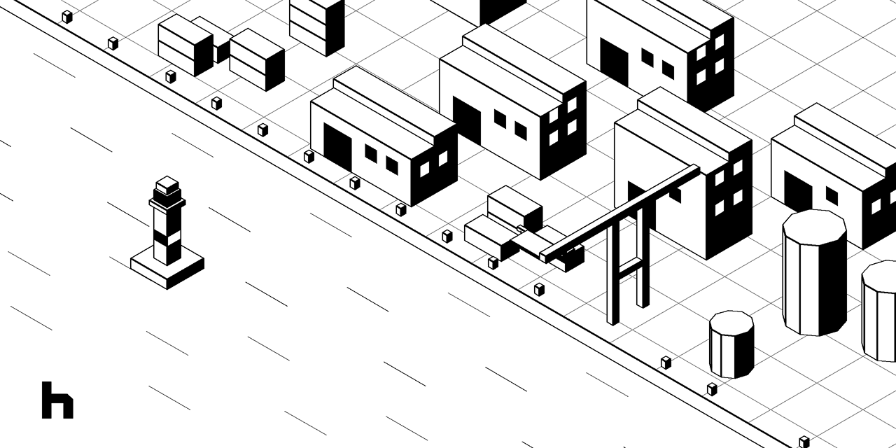

# Hafen

> *Hafen* is German for **harbour**.



**Test chat endpoints like your users talk to them.** Send messages to any chat API and watch the replies stream
in as a conversation. Check every reply. See every step of a run on a timeline. Then run the same
test files in CI.

Your endpoint, its conversations, the checks on them, their runs and your CI job: one place, one set
of files.

## Why Hafen

- **Any chat endpoint.** Plain HTTP (one JSON reply, SSE or NDJSON streams), WebSocket, or presets
  for OpenAI (Chat Completions and Responses), Anthropic Messages, Gemini and Ollama. Anything else
  takes a small plugin.
- **See what really happened.** Each reply shows its thinking, tool calls, text, timings and a badge
  for every check, live as it streams. The timeline draws every step of the run as a bar: requests,
  thinking, tool calls, the answer, judge calls.
- **Checks that say why.** Rule checks (JSONPath, status, latency, length, tokens, cost, tool calls,
  thinking, the order of events) and judged checks (TypeSafe's System One, LLM judges with rubrics,
  reference answers). Every result is pass, fail, unsure, skipped or error, always with a reason, and
  judged results carry a confidence.
- **Tests are files in your repository.** Suites are plain YAML. The app edits them in place and keeps
  your comments, key order and formatting, so adding a check is a one-line diff.
- **The same tests in CI.** The command-line runner runs those files unchanged, exits with a clear
  code and writes JUnit, Markdown, JSON and run files. Open a CI run in the app to see its
  conversation and timeline.
- **Secrets stay secret.** Secrets are `${env:NAME}` only, never written to files. The desktop app
  stores them encrypted by the system. They're redacted from every run file and report, and plugins
  never see their values.

## One engine, three ways to use it

| | Start it | For |
|---|---|---|
| **Desktop app** | `npm run app` | Exploring endpoints, building tests and reading results. The engine runs in a background process, so endpoints that refuse web pages still work |
| **Command line** | `node cli/hafen.js run tests/` | CI. Runs suite files unchanged, exits `0`/`1`/`2`/`3`, writes reports, compares with a baseline |
| **Browser build** | `npm run build`, then `node cli/hafen.js serve --allow-endpoint <url>` | The same app in a browser, with a relay for endpoints that refuse web pages |

## A test, in a file

```yaml
# tests/support/refund.hafen.yml
version: 1
name: Support bot · refunds
provider: providers/acme.yml

environments:
  local:   { base_url: "http://localhost:8791" }
  staging: { base_url: "https://staging.acme.example" }

judges:
  default: { kind: systemone }                     # TypeSafe's System One
  rubric:  { kind: llm, provider: claude, samples: 3 }
providers:
  claude: { kind: anthropic-messages, model: claude-opus-5-5 }

tests:
  - name: refund for a broken item
    repeat: 3
    pass_rate: 0.67
    turns:
      - user: I want a refund for order 4417
        expect:
          - { type: status, equals: 200 }
          - { path: $.reply.order.id, equals: 4417 }
          - { type: latency, max_ms: 3000 }
          - { type: systemone.noul, question: "Does the reply ask why they want a refund?", min: 0.8 }
      - user: It arrived broken
        expect:
          - { type: judge, judge: rubric, rubric: [Offers a refund without asking for a photo first] }
```

The app builds this file as you click (send messages, **Save as test**, click a value in a reply to
check it), and the CLI runs it as it is.

## Quick start

You need Node 22 or newer.

```sh
npm ci
npm run mock      # a local endpoint on :8791 to try things on, in its own terminal
npm run app       # the desktop app
```

Then follow [Getting started](docs/getting-started.md): connect to the mock endpoint, send a
message, save it as a test, and run it from the command line.

## Documentation

| Page | What's in it |
|---|---|
| [Getting started](docs/getting-started.md) | Install, explore an endpoint, save your first test, run it from the command line |
| [The app](docs/app.md) | The desktop app and the browser build: the layout, exploring, building tests, runs, the timeline, settings, shortcuts |
| [Test files](docs/test-files.md) | The suite format: tests, turns, variables, environments and scopes, data files, groups, validation |
| [Providers](docs/providers.md) | Connecting to an endpoint: HTTP, streams, WebSocket, presets, conversation history, thinking |
| [Checks and judges](docs/checks.md) | Every check, its operators, System One and LLM judges, confidence and unsure results |
| [Plugins](docs/plugins.md) | Your own providers, checks and judges, in JavaScript |
| [Command line](docs/cli.md) | `run`, `validate`, `report`, `compare`, `serve`: options, exit codes, output, reports |
| [Running in CI](docs/ci.md) | A GitHub Actions workflow, secrets, baselines and regressions |
| [Development](docs/development.md) | How the project is built, its tests, and how to work on it |
