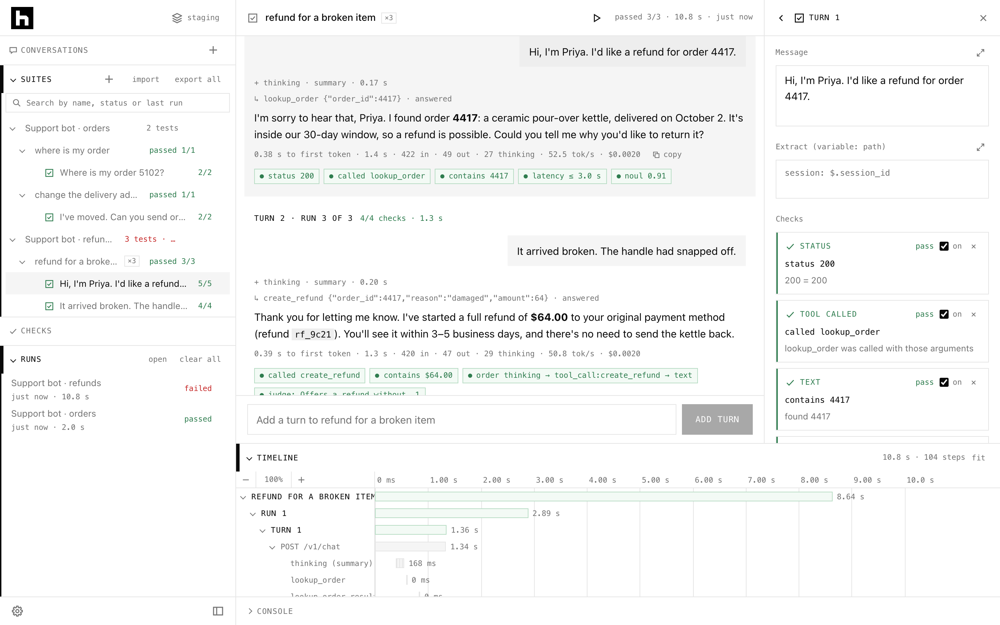
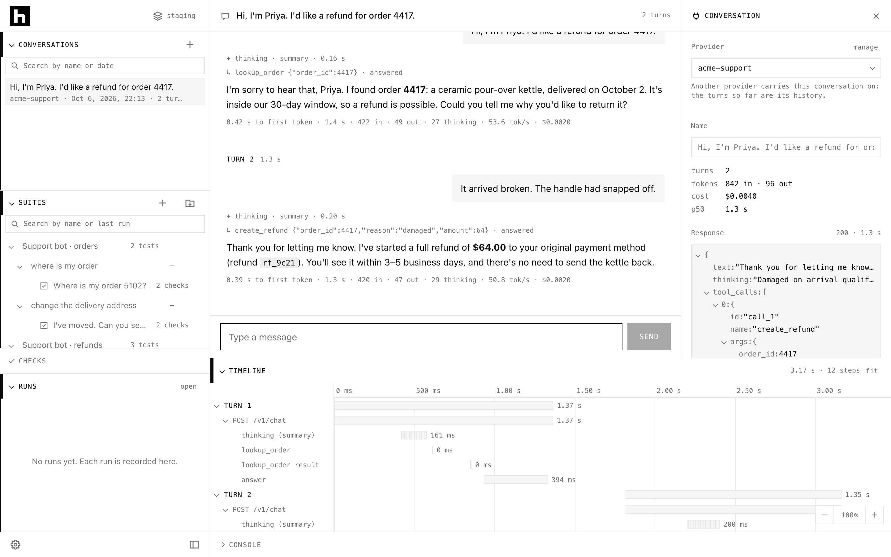
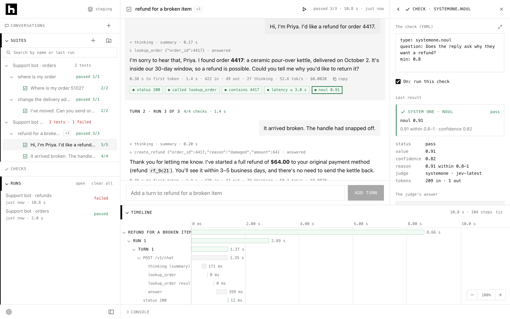
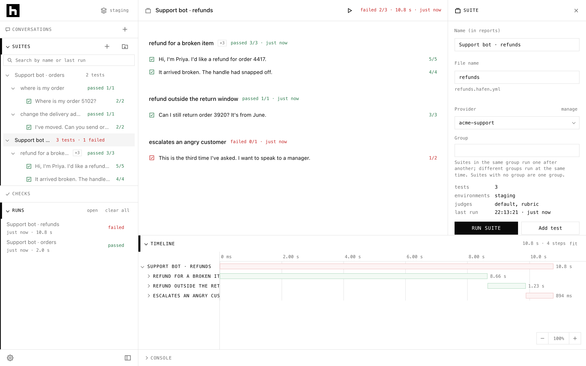

# Hafen

**Test chat endpoints like your users talk to them.** Send messages to any chat API and watch the replies stream
in as a conversation. Check every reply. See every step of a run on a timeline. Then run the same
test files in CI.

Your endpoint, its conversations, the checks on them, their runs and your CI job: one app that keeps
your work, and plain files to commit.

> **Proof of concept.** Hafen is at an early stage, and testing of its features is in progress. Expect
> rough edges, and please report what you find.

## Demo
https://github.com/user-attachments/assets/6305c5f4-78a3-4f33-bb85-9bbaf3f427d9

## Why Hafen

- **Any chat endpoint.** Plain HTTP (one JSON reply, SSE or NDJSON streams), or presets for OpenAI
  (Chat Completions and Responses), Anthropic Messages, Gemini and Ollama. Anything else takes a
  small plugin, and an endpoint behind a login takes a fixture that logs in first.
- **See what really happened.** Each reply shows its thinking, tool calls, text, timings and a badge
  for every check, live as it streams. The timeline draws every step of the run as a bar: requests,
  thinking, tool calls, the answer, judge calls.
- **Checks that say why.** Rule checks (JSONPath, status, latency, length, tokens, cost, tool calls,
  thinking, the order of events) and judged checks (TypeSafe's System One, LLM judges with rubrics,
  reference answers). Every result is pass, fail, unsure, skipped or error, always with a reason, and
  judged results carry a confidence.
- **The app keeps your tests; Export makes them files.** Open the app and start: there's no folder to
  pick. It keeps your suites, providers and plugins as plain YAML and JavaScript, and **Export**
  writes them, with everything they use, to a folder in your repository, where the CLI runs them as
  they are. The app keeps your comments, key order and formatting, so adding a check is a one-line
  diff. **Import** brings suites in from files or a folder.
- **The same tests in CI.** The command-line runner runs the exported files unchanged, exits with a
  clear code and writes JUnit, Markdown, JSON and run files. Open a CI run in the app to see its
  conversation and timeline.
- **Secrets stay secret.** Files name a secret as `{{secret.NAME}}`, never its value. The desktop
  app keeps secrets encrypted by the system, for each scope (staging, prod) and for Globals, which a
  scope falls back to for a name it hasn't got; the command line reads them from the files you name
  (`--secret globals.secret.env --secret staging.secret.env`, the later winning), or the environment. They're redacted from every run file and report,
  also where they show escaped, URL-encoded or in base64, and plugins never see their values.

## Screenshots

The images follow your GitHub theme, light or dark.

**A test after its run.** Each reply shows its thinking, tool calls and text, a stats line, and a
badge for every check. The panel shows the selected turn's checks, and the timeline shows every
step of the run.

<picture>
  <source media="(prefers-color-scheme: dark)" srcset="docs/screenshots/test-dark.png">
  
</picture>

**Exploring an endpoint.** Send messages to try an endpoint, then save the conversation as a test.

<picture>
  <source media="(prefers-color-scheme: dark)" srcset="docs/screenshots/explore-dark.png">
  
</picture>

**A judged check.** A System One check's value, confidence and reason, with the judge's full answer.

<picture>
  <source media="(prefers-color-scheme: dark)" srcset="docs/screenshots/check-dark.png">
  
</picture>

**A suite.** Every test's last result, with the whole run's timeline.

<picture>
  <source media="(prefers-color-scheme: dark)" srcset="docs/screenshots/suite-dark.png">
  
</picture>

## One engine, two ways to use it

| | Start it | For |
|---|---|---|
| **Desktop app** | `npm run app` | Exploring endpoints, building tests and reading results. It keeps your work; Export writes suites to a folder for git and CI. The engine runs in a background process, so endpoints that refuse web pages still work |
| **Command line** | `npx hafen run tests/ --env tests/staging.env --secret staging.secret.env` | CI. Runs an exported folder's suites unchanged, exits `0`/`1`/`2`/`3`, writes reports, compares with a baseline. `pack` puts suites and everything they need into one file that runs anywhere with Node alone |

The engine and the command line are one package, [`hafen`](packages/hafen/README.md)
(`packages/hafen/`), installed on its own for CI: it brings no Electron, React or Playwright.
(**TODO:** `hafen` isn't published to npm yet: install it from a clone of this repository, as
[Quick start](#quick-start) shows.) The app (this repository's root: the UI, the desktop app and the browser build's server)
depends on it.

## A test, in a file

```yaml
# tests/support/refund.hafen.yml
version: 1
name: Support bot · refunds
provider: providers/acme.yml

environments:                                      # {{env.base_url}}, for the environment chosen
  local:   { base_url: "http://localhost:8791" }
  staging: { base_url: "https://staging.acme.example" }

judges:
  default: { kind: systemone }                     # TypeSafe's System One
  rubric:  { kind: llm, provider: claude, samples: 3 }
providers:
  claude: { kind: anthropic-messages, model: claude-opus-5-5 }

tests:
  - name: refund for a broken item
    repeat: 3
    pass_rate: 0.67
    turns:
      - user: I want a refund for order 4417
        expect:
          - { type: status, equals: 200 }
          - { path: $.reply.order.id, equals: 4417 }
          - { type: latency, max_ms: 3000 }
          - { type: systemone.noul, question: "Does the reply ask why they want a refund?", min: 0.8 }
      - user: It arrived broken
        expect:
          - { type: judge, judge: rubric, rubric: [Offers a refund without asking for a photo first] }
```

The app builds this file as you click (send messages, **Save as test**, click a value in a reply to
check it), **Export** writes it (and `providers/acme.yml`) to your repository, and the CLI runs it as
it is. `providers/acme.yml` says where to send it:
`url: "{{env.base_url}}/chat"`, a value of the environment chosen (the app's scope over its Globals,
or the `--env` files, the later winning; then the suite's own `environments:` block of that name), and `"Bearer {{secret.ACME_KEY}}"`, a secret the app
keeps, or the CLI reads from a `--secret` file or the environment.

## Quick start

You need Node 22 or newer.

```sh
npm ci
npm run mock      # a local endpoint on :8791 to try things on, in its own terminal
npm run app       # the desktop app
```

Then follow [Getting started](docs/getting-started.md): connect to the mock endpoint, send a
message, save it as a test, export it to a folder, and run it from the command line. Inside this repository the command
line is `npx hafen …` (npm links the workspace's `hafen`), or `node packages/hafen/cli/hafen.js …`.

In CI, the command line needs only the `hafen` package, and a pack (`hafen pack`: your suites and
everything they need in one file) needs only Node: see [Running in CI](docs/ci.md). Export your
suites to `tests/` in your repository, commit it, and install the package.

**TODO: `hafen` isn't published to npm yet.** Until it is, `npm install hafen` won't find it: make
the package from a clone of this repository, and install that:

```sh
git clone <this repository's URL> hafen-src
npm pack -w hafen --prefix hafen-src     # hafen-0.1.0.tgz, made from hafen-src/packages/hafen
npm install --save-dev ./hafen-0.1.0.tgz
npx hafen run tests/ --env tests/staging.env --secret staging.secret.env
```

(Once it's published, the first three lines are just `npm install --save-dev hafen`.)

## Documentation

| Page | What's in it |
|---|---|
| [Getting started](docs/getting-started.md) | Install, explore an endpoint, save your first test, export it, run it from the command line |
| [The app](docs/app.md) | The desktop app and the browser build: the layout, exploring, building tests, runs, the timeline, settings, importing and exporting suites, shortcuts |
| [Test files](docs/test-files.md) | The suite format: tests, turns, variables, environments and secrets, data files, groups, validation |
| [Providers](docs/providers.md) | Connecting to an endpoint: HTTP, streams, presets, logins, conversation history, thinking |
| [Checks and judges](docs/checks.md) | Every check, its operators, System One and LLM judges, confidence and unsure results |
| [Plugins](docs/plugins.md) | Your own providers, checks, judges and login fixtures, in JavaScript, importing any file or package |
| [Command line](docs/cli.md) | `run`, `validate`, `report`, `compare`, `pack`: options, environments and secrets, exit codes, output, reports |
| [Running in CI](docs/ci.md) | Exporting suites into your repository, installing the `hafen` package, a GitHub Actions workflow, running a pack, secrets and `.env` files, baselines and regressions |
| [Development](docs/development.md) | How the project is built (the app, and the `hafen` package in `packages/hafen/`), its tests, and how to work on it |


> *Hafen* is German for **harbour**.

---

**Disclaimer:** This project was built with the assistance of AI coding tools. AI-generated code may contain errors or vulnerabilities. Please review and test the code before using it in production.
